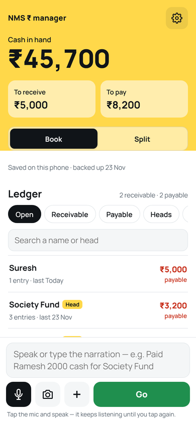
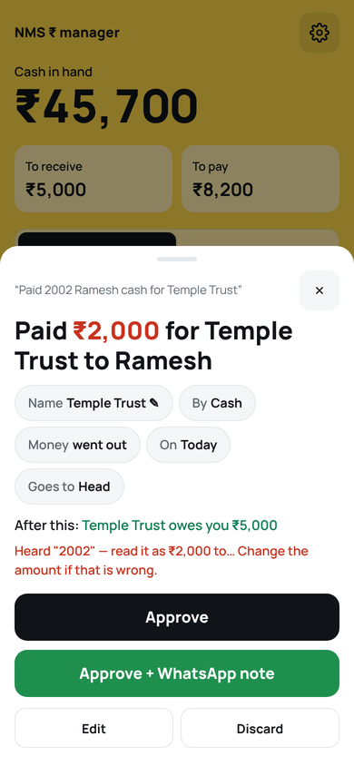
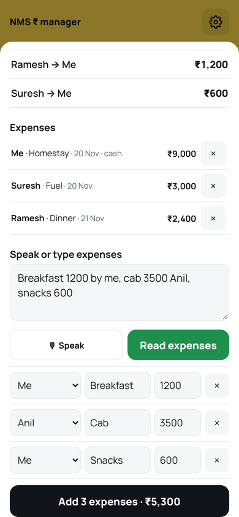
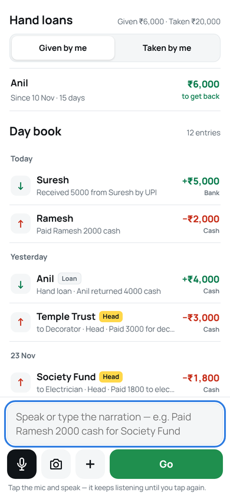
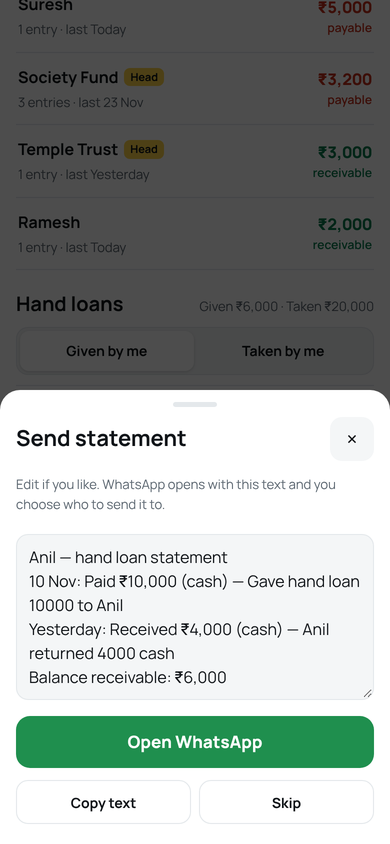
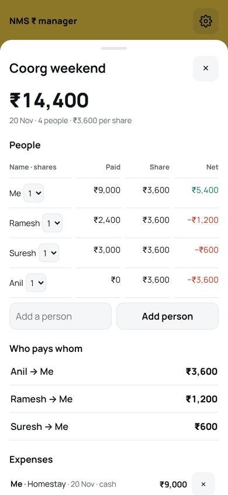
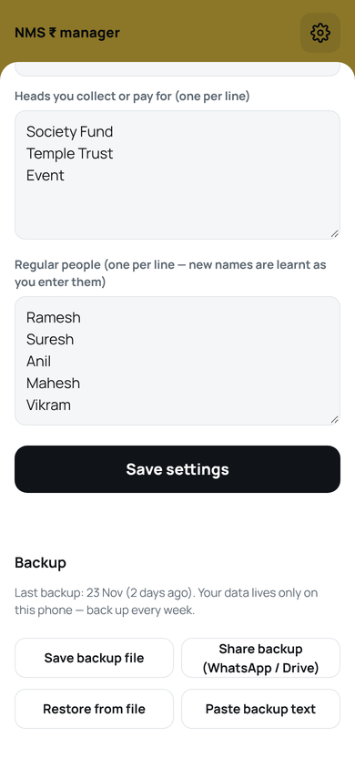

# NMS ₹ manager

**Speak one sentence. Tap approve. Know where every rupee is.**

> ### 🌱 Do you use AI to split your bills or record your transactions?
> NMS ₹ manager does it right on your phone — **without going to AI every time**.
> Fewer tokens consumed, less electricity wasted: **more for the environment, less on the carbon bill.**
>
> No AI call per entry · Works offline · Data stays on your phone

A personal cash book for the phone. Say *"Paid Ramesh 2000 cash for Society Fund"* and the app works out the amount, the person or head, cash or bank and the date, then shows a card you approve with one tap. It keeps cash in hand, who owes you, whom you owe, hand loans and trip splits tallied, and it runs on iPhone and Android without internet.

**Open the app:** https://raw.githack.com/nimit010/nms-rupee-manager/main/index.html

*Screenshots show made-up sample data.*

## What it does

| | |
| --- | --- |
| **Voice entry** | Mic, keyboard mic or Wispr Flow. One sentence becomes a complete entry. |
| **One-tap approve** | A card shows what was understood and the balance after it. Every detail is a tap to change. Undo after saving. |
| **Decides for you** | Heads → that head; loan / udhar → hand loans; ATM or deposit → own cash; anyone else → ledger. Cash unless you say UPI, GPay, NEFT, cheque or bank. |
| **Understands Indian speech** | "2002 Pavan" (for "two thousand to Pavan") → ₹2,000 to Pavan; "two thousand five hundred", hazaar, lakh; Hindi-English mix such as "se … liya", "udhar", "kal"; sound-alike names. Learns each name you correct. |
| **Book at a glance** | Cash in hand, receivable, payable, ledger of people and heads, hand loans with days outstanding, day book. |
| **Statements and settle** | Tap a name for its statement; settle in one tap; copy or send on WhatsApp. |
| **WhatsApp notes** | Approve + WhatsApp opens WhatsApp with an acknowledgement and the balance due; you pick the contact. |
| **Receipt photos** | Take a photo with the entry; view it later from the day book. |
| **Splits** | Trips, outings, dinners. Speak many expenses at once, weighted shares, rounding to ₹1/10/50/100 with no loose change, fewest payments to settle, post your part to the ledger, close with a one-line log. |
| **No AI needed** | Amounts, names, heads, Hindi-English and misheard words are worked out on the phone itself — no AI server, no tokens, no internet for each entry. |
| **Offline and private** | Data stays on the phone (IndexedDB). Backup to a file, WhatsApp or Google Drive; restore on a new phone. |

## Install on your phone

No app store needed.

**iPhone**
1. Open https://raw.githack.com/nimit010/nms-rupee-manager/main/index.html in **Safari**.
2. Tap **Share** (square with an arrow) → **Add to Home Screen** → **Add**.
3. Open **NMS ₹ manager** from the home screen. If the app's mic doesn't respond, use the keyboard mic.

**Android**
1. Open https://raw.githack.com/nimit010/nms-rupee-manager/main/index.html in **Chrome**.
2. Tap **⋮** → **Install app** (or **Add to Home screen**) → **Install**.
3. Open it from the home screen and allow the microphone. It listens in Indian English until you tap the mic again.

After the first open the app works without internet.

## Backup

Your data lives only on your phone. In **Settings**:
- **Save backup file** or **Share backup** to WhatsApp or Google Drive — the app reminds you after 7 days.
- **Restore from file** on a new phone, or **Paste backup text** copied from the Claude version of the app.

## Full guide

An illustrated A4 guide: [docs/NMS-Rupee-Manager-Guide.pdf](docs/NMS-Rupee-Manager-Guide.pdf)

## Files

`index.html` (the whole app), `manifest.webmanifest` and icons (install), `sw.js` (offline). No build step and no server: GitHub Pages serves the files as they are.
